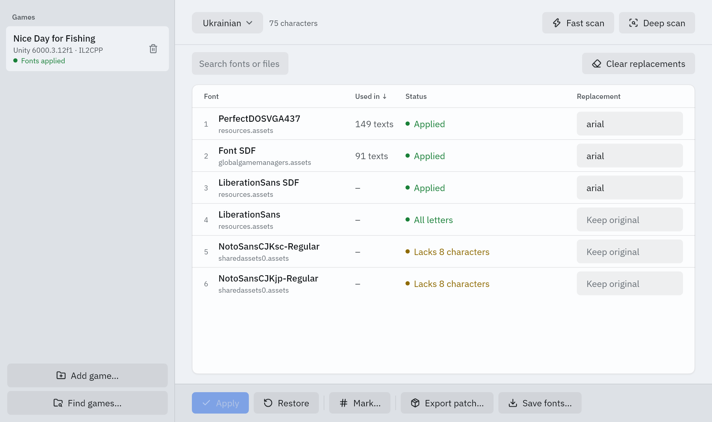
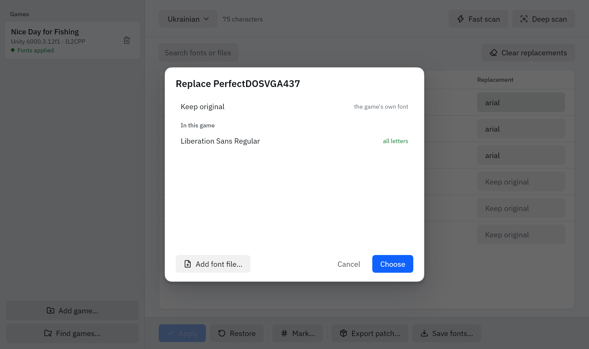
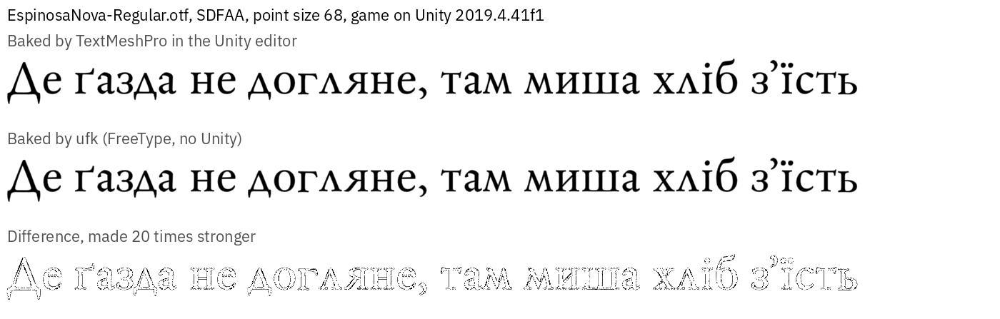
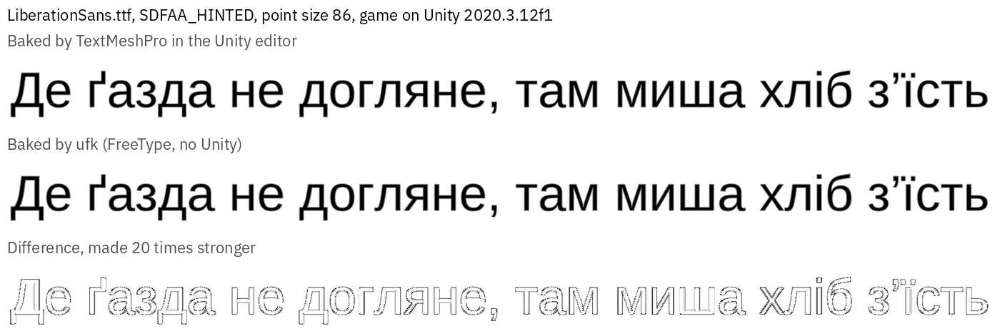
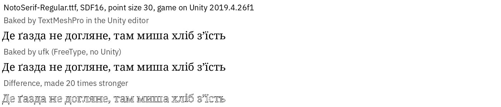
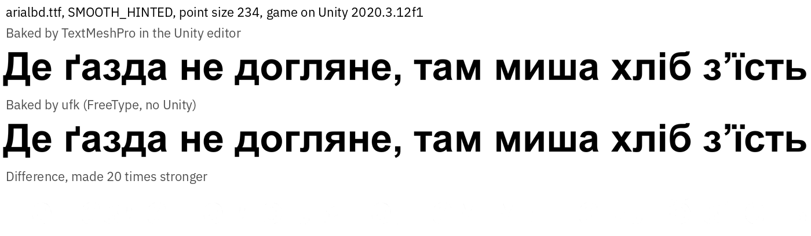

# unity-font-kit (`ufk`)

`ufk` replaces fonts in Unity games, so a translation can show letters the game's fonts do not have.



## Download

1. Download `ufk-windows-x64.zip` or `ufk-linux-x64.tar.gz` from [Releases](https://github.com/idrmn/unity-font-kit/releases).
2. Unpack the archive.
3. Run `ufk`.

## Replace a font

1. Click **Add game...** and select the game folder.
2. Select your language at the top. For your own set of characters, select **Custom...**.
3. Click **Fast scan**. If a font is missing from the list, click **Deep scan**. It reads every game file and takes longer.
4. In the **Replacement** column, click the button of a font that lacks letters.
5. Select a font from the game, or click **Add font file...** and select a TTF or OTF file.
6. Click **Choose**.
7. Close the game and click **Apply**.
8. Start the game and check the text.

To put the original files back, close the game and click **Restore**.

**Save fonts...** saves the game's own fonts as TTF or OTF files, and TextMeshPro atlases as PNG, for work in a font editor.



## Find which font is which

A font's name rarely tells where the game shows it, and some games swap fonts at run time.

1. Click **Mark...** and tick the fonts you want to find.
2. Click **Generate**. Each marked font draws its number from the table over every letter. The text stays readable.
3. Start the game and note the numbers on screen.
4. Close the game and click **Unmark**. The game gets back what it had before: the original fonts or your applied fonts.

A font keeps its number when you sort the table or scan again.

## Share with players

Apply your fonts and check them in the game first. Both ways below fit only the game version you made them for.

**Patch zip.** Click **Export patch...** and save the zip. It holds only the differences and scripts that install and undo them. If a player has another game version, the script changes nothing.

**Changed files.** After **Apply**, the changed game files are in the `patched` folder, in the same layout as the game's `_Data` folder:

```
%LOCALAPPDATA%\ufk\projects\<game>\<game>.ufk\patched           (Windows)
~/.local/share/ufk/projects/<game>/<game>.ufk/patched           (Linux)
```

`<game>` is the game's name with a short code, for example `nice-day-for-fishing-d82d825d`. Players copy these files over their own.

## How the new fonts look

`ufk` draws TextMeshPro atlases with FreeType, without Unity. Each image shows a line from an atlas the Unity editor made, the same line from `ufk`, and their difference made 20 times stronger.









## Data and downloads

`ufk` keeps its data in `%LOCALAPPDATA%\ufk` on Windows and `~/.local/share/ufk` on Linux.

Two steps need an internet connection the first time:

- IL2CPP games: `ufk` downloads [Cpp2IL](https://github.com/SamboyCoding/Cpp2IL) to read the game's code.
- **Export patch...**: `ufk` downloads [xdelta](https://github.com/jmacd/xdelta) to make the patches.

## Build

1. Install [Rust](https://rustup.rs). On Windows, use the MSVC toolchain.
2. In the repository folder, run:

```sh
cargo build --release
```

The program is `target/release/ufk` (`ufk.exe` on Windows).

## License

MIT, see [LICENSE](LICENSE). Portions of this software are copyright © The FreeType Project (www.freetype.org). All rights reserved.
